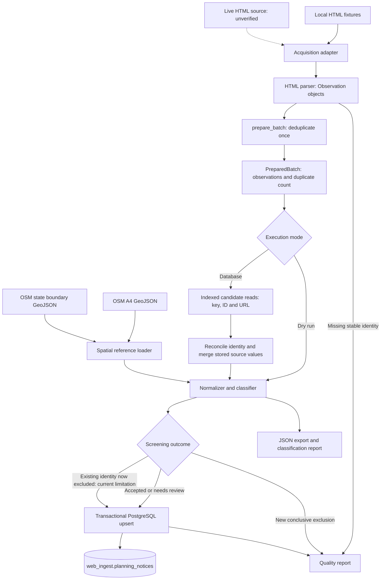
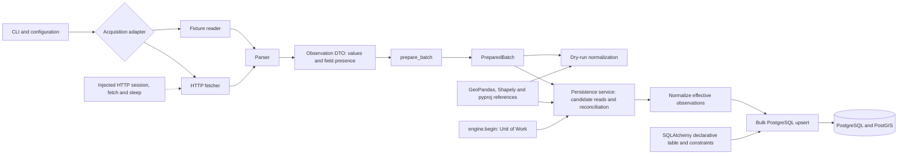
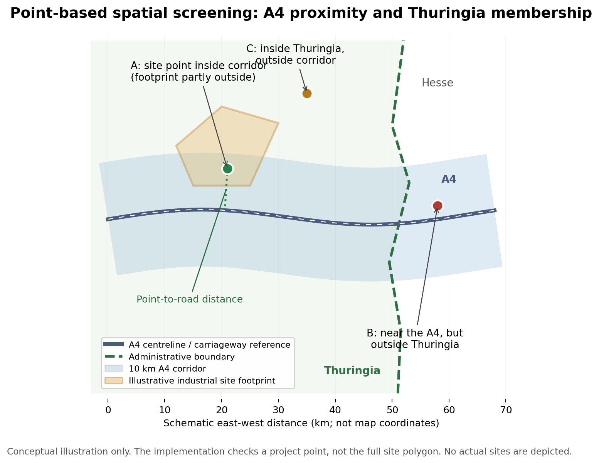
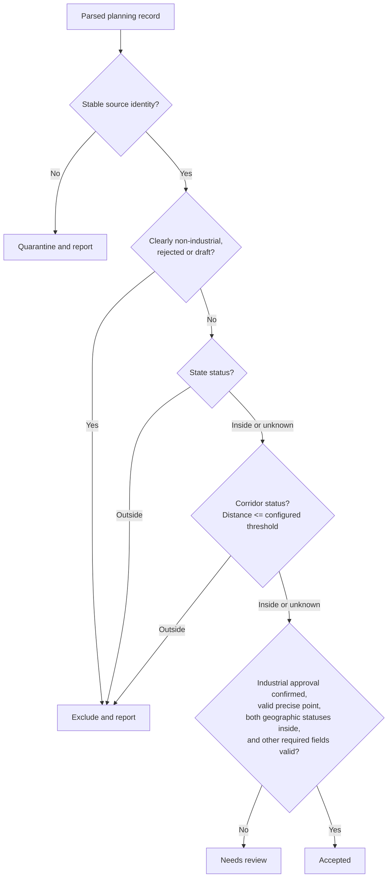
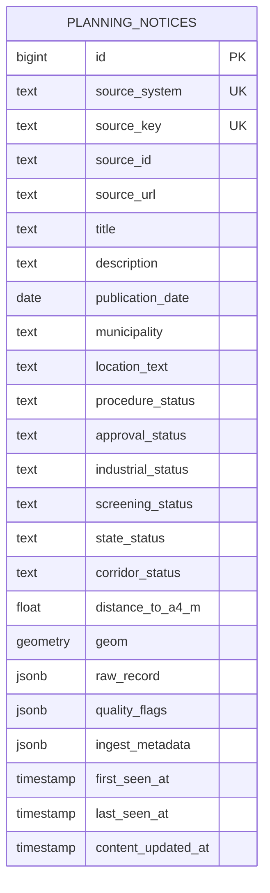
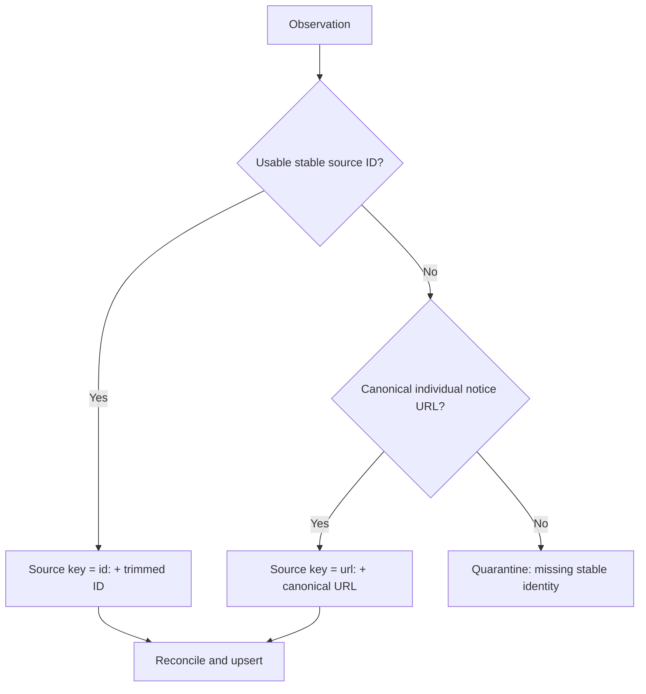
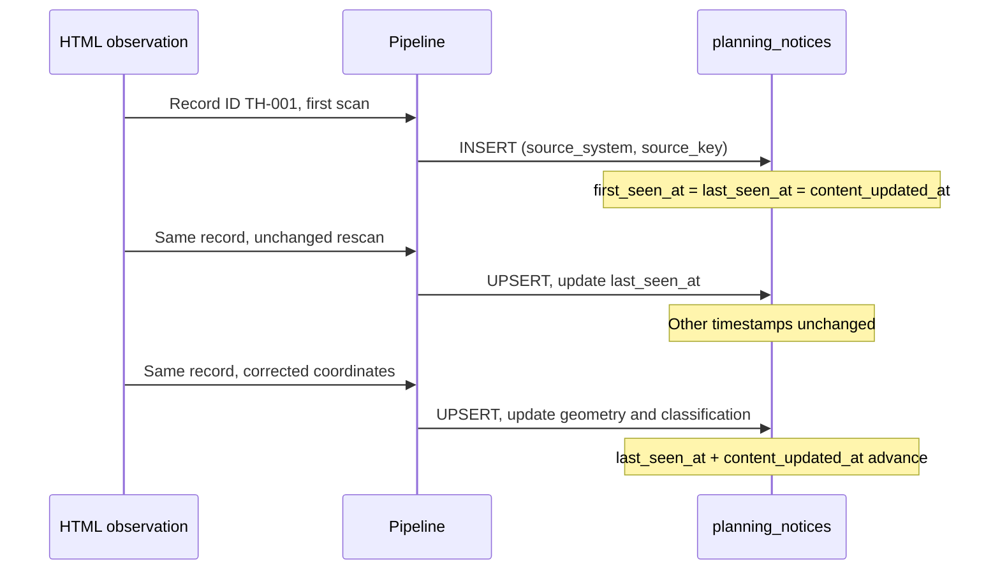
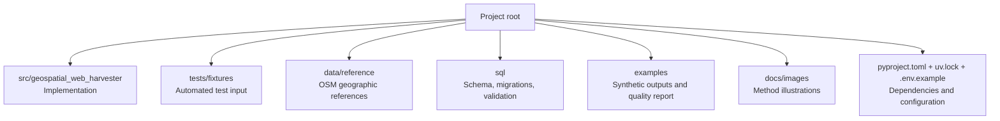

# Geospatial-Web-Harvester

**A Python/PostGIS prototype demonstrating traceable HTML ingestion, geospatial screening and idempotent persistence.**

**Topics:** `python` `data-engineering` `web-scraping` `etl` `geospatial` `postgresql` `postgis` `geopandas` `sqlalchemy`

The project combines structured web extraction, explicit data-quality rules, projected spatial analysis and transactional database updates. A fixture-based example screens industrial planning and approval notices against the A4 motorway corridor and the Thuringia administrative boundary in Germany. The geographic references contain real OpenStreetMap data; the announcements are synthetic.

The implementation demonstrates a complete, tested ingestion pipeline. Its HTML selectors and domain rules are specific to the example fixtures; live-source integration remains unverified.

| Prototype at a glance | Implementation |
| --- | --- |
| Example screening scenario | Identify potentially relevant industrial approvals within Thuringia and within a configurable distance of the A4 |
| Data acquisition | HTML source adapter with separate local-fixture and live-HTTP modes |
| Spatial references | Real OpenStreetMap A4 road geometry and Thuringia administrative boundary |
| Spatial calculation | **Source-provided project location point**; distance to A4 and point-in-state test in EPSG:25832 |
| Default corridor | **10 km** from the motorway, inclusive; an explicit prototype assumption |
| Destination | PostgreSQL 16 / PostGIS 3.4, `web_ingest.planning_notices` |
| Demonstrated execution | Synthetic fixtures, automated unit tests, and local PostGIS integration tests |
| Source limitation | The target portal was unavailable; live HTML structure and pagination remain unverified |

> **Interpretation boundary:** A qualifying record has a *point* inside the A4 corridor and the Thuringia boundary. This does **not** establish that the complete industrial site footprint lies within the corridor. A site's shape, area, or intersection with the corridor is **not** evaluated by this prototype.

## Quick start (no database required)

With Python 3.12 and `uv` installed, from the repository root:

```sh
uv sync --locked
uv run geospatial-web-harvester --dry-run
uv run pytest -ra
```

The dry run parses the default **synthetic** HTML fixture, validates the real geographic references, and produces a report **without connecting to PostgreSQL**. For database-backed execution, see [setup](#setup-and-local-development), [configuration](#configuration-and-environment-files), and [running the harvester](#running-the-harvester).

## Contents

1. [What this prototype does](#what-this-prototype-does)
2. [System architecture and ETL workflow](#system-architecture-and-etl-workflow)
3. [Geographic method and spatial limitations](#geographic-method-and-spatial-limitations)
4. [Data model and database design](#data-model-and-database-design)
5. [Record identity, reconciliation, and rescans](#record-identity-reconciliation-and-rescans)
6. [Filtering, missing values, and quality reporting](#filtering-missing-values-and-quality-reporting)
7. [Project structure](#project-structure)
8. [Setup and local development](#setup-and-local-development)
9. [Configuration and environment files](#configuration-and-environment-files)
10. [Running the harvester](#running-the-harvester)
11. [Running the tests and validating the database](#running-the-tests-and-validating-the-database)
12. [Efficiency and implementation choices](#efficiency-and-implementation-choices)
13. [Verification status and limitations](#verification-status-and-limitations)
14. [Future improvements](#future-improvements)
15. [Reference data and attribution](#reference-data-and-attribution)

---

## What this prototype does

The example use case identifies industrial planning and approval signals, checks their location against a motorway corridor and an administrative boundary, and persists traceable results in PostGIS.

The original portal could not be accessed during development. Consequently, the pipeline was demonstrated using **two deliberately constructed HTML fixtures**, not actual notices from the portal. The fixture HTML is representative test material; its selectors, projects, dates, coordinates, and `.invalid` links must not be presented as observed source data.

The two geographic reference datasets, unlike the notices, contain **real OpenStreetMap geometries**. They provide an independent basis for geographic calculations, but do not establish that any synthetic industrial project is real.

**Implemented scope**

- Acquire local fixture HTML or use a separately configurable HTTP acquisition adapter.
- Extract source records, retaining original source-field values and which fields were explicitly present.
- Normalize dates, source identity, industrial relevance, approval evidence, coordinates, and quality flags.
- Check both **Thuringia membership** and **A4 distance** for valid project points.
- Insert/update records with stable identities and a transactional, idempotent PostgreSQL upsert.
- Generate sample output, validation queries, and a quality report that accounts for exclusions, ambiguous records, and parsing errors.
- Test parsing, transformations, mocked HTTP behavior, geometry, and database operations without depending on the inaccessible portal.

**Not demonstrated:** successful retrieval or parsing of the real portal; actual pagination selectors; the correctness of real-source publication dates or planning-status semantics; end-to-end ingestion of real approvals.

## System architecture and ETL workflow

### End-to-end ETL



Acquisition must complete before persistence starts. Dry runs use incoming source values directly and do not connect to the database. Database runs first retrieve matching stored records and merge effective source values, then classify and upsert inside one transaction. Existing identities that become conclusively excluded are currently retained with warnings; this limitation is described under filtering below.

The diagram's upsert and database paths apply only to database mode. Dry-run classifications feed the export and quality report without writing rows.

### Component architecture and design patterns



The main architectural choices are deliberately modest:

| Choice | Why it is used |
| --- | --- |
| **Layered ETL** | Keeps acquisition, parsing, transformation, and persistence independently understandable and testable. |
| **Dependency injection** | HTTP session, fetch function, and retry sleep function can be substituted for deterministic network tests. |
| **Adapter-style acquisition** | Fixture input and HTTP input feed the same downstream pipeline; no duplicate business logic. |
| **Observation data transfer object** | A dataclass carries values, explicit field presence, and observation flags across stages. |
| **Prepared batch contract** | `PreparedBatch` groups unique observations and the duplicate count. Both execution modes share `prepare_batch()`; prepared persistence does not deduplicate again. |
| **SQLAlchemy declarative mapping** | `PlanningNotice` declares the table and constraints; persistence uses SQLAlchemy Core dictionaries and PostgreSQL upserts rather than passing ORM entities through the pipeline. |
| **Unit of Work** | `engine.begin()` owns a complete persistence batch: commit together or roll back on failure. |

These patterns are used where they add clarity; the prototype does not introduce a large framework, a UI, or unnecessary abstraction layers.

## Geographic method and spatial limitations

### Two independent geographic conditions

The geographic reference comprises:

| Dataset | Purpose |
| --- | --- |
| [`data/reference/a4_thueringen.geojson`](data/reference/a4_thueringen.geojson) | A4 motorway lines; includes the relevant section through neighboring Hessen so proximity remains continuous. |
| [`data/reference/thueringen_boundary.geojson`](data/reference/thueringen_boundary.geojson) | Thuringia administrative MultiPolygon; determines whether the project point is located in the target state. |

For a point with validated, sufficiently precise coordinates:

```text
state_status    = inside, if Thuringia polygon covers the point
corridor_status = inside, if distance(point, A4 lines) <= A4_BUFFER_METERS
spatial_match   = both statuses are inside
```

The configured default is `A4_BUFFER_METERS=10000` (10 km). This is an **analytical assumption**, not a corridor width specified by the source. The exact boundary and the exact distance threshold are inclusive. All distance calculations use projected **EPSG:25832** coordinates, not angular longitude/latitude degrees.

The mathematical study region is the intersection of the Thuringia boundary and a 10 km buffer around the A4 lines.

The implementation evaluates the two conditions directly for each point; it does **not** construct a full corridor buffer for every record.

### Spatial example: project location points and site footprints



*Conceptual illustration; not a real map or real industrial sites. A and C are in the illustrative state, B is outside. The road geometry is illustrative. The actual pipeline uses the supplied OSM references.*

- **Site A:** Its project **location point** is within 10 km of the A4 and inside Thuringia. It passes the *spatial* test even though the illustrated industrial site polygon extends **beyond the corridor**.
- **Site B:** Its point is near the A4 but in Hessen. It fails the *state* test.
- **Site C:** Its point is inside Thuringia but farther than 10 km from the A4. It fails the *corridor* test.
- **No usable coordinates:** Both geographic classifications are `unknown`; the application does not invent a point from a municipality name.

**Important:** Spatial evaluation uses a source-provided project location point. The implementation does not calculate a site centre or geocode addresses. The point does not describe a parcel or full industrial-site polygon, so the result says nothing about whether *all, most, or any specific percentage* of an industrial site's area is within the corridor. Accurate footprint screening would require polygon geometries and additional intersection/area calculations.

### Why the A4 geometry includes part of Hessen

An initial Thüringen-only OSM extraction omitted approximately 6.6 km of the A4 near **Wommen and Herleshausen**, where the motorway runs through Hessen. The road reference must include that segment to preserve a continuous distance reference; a *separate* administrative polygon excludes non-Thuringian projects.

The supplied reference files were reported as locally validated with:

- **A4:** 1,245 valid line features; two carriageway chains; approximately 382.872 km total line geometry; the earlier longitudinal gap resolved.
- **Thuringia:** one valid MultiPolygon, approximately 16,198.113 km² in EPSG:25832; two extra point members ignored with warnings.

Reference validation checks geometry type and validity, CRS, finite coordinates, reasonable regional extent, road connectivity and gaps, and plausible state geometry. Separate motorway carriageways are not forcibly joined. The geometry-connectivity tolerance (1 km) is **not** the study corridor width (10 km). These checks support reproducibility but do not independently certify OSM completeness or cadastral accuracy.

### Screening decision flow



Conclusive geographic exclusion takes precedence even when approval evidence is uncertain. The corridor threshold defaults to 10 km and includes points exactly at that distance; state membership includes points on the boundary. The exclusion outcome is reported for all identities; the current exception for previously stored identities is documented below.

## Data model and database design

The destination is a **single staging table**: `web_ingest.planning_notices`. The database schema (`web_ingest`) is a namespace; the table (`planning_notices`) stores normalized observations. `sql/init.sql` defines the schema, including unique constraints, spatial checks, a GiST index and nonunique identity lookup indexes. The SQLAlchemy model and bootstrap/migration index definitions are checked for consistency by tests.

### Logical database structure



*Logical overview of important fields, not a generated SQL schema dump. `UNIQUE(source_system, source_key)` is a **composite** uniqueness constraint; the diagram labels both parts as UK for readability. Consult `sql/init.sql` and the SQLAlchemy model for precise column names, types, defaults, nullability, and additional fields (including quality and procedure attributes).*

| Field group | Examples | Treatment |
| --- | --- | --- |
| **Identity and provenance** | `id`, `source_system`, `source_key`, `source_id`, `source_url` | Stable row identity and source traceability. |
| **Source content** | `title`, description, `publication_date`, `municipality`, `location_text`, source procedure status | Missing values may remain `NULL`; they are not fabricated. |
| **Classifications** | `approval_status`, `industrial_status`, `state_status`, `corridor_status`, `screening_status` | Derived, reviewable decisions. |
| **Spatial fields** | `geom`, `distance_to_a4_m` | Point in EPSG:25832; nullable if location cannot be resolved. |
| **Original extracted fields** | `raw_record` (`JSONB`) | Direct source-field mapping rather than an HTML dump. |
| **Processing provenance** | `ingest_metadata` (`JSONB`) | Observation flags, A4 and boundary reference identifiers/hashes, corridor configuration. |
| **Lifecycle** | `first_seen_at`, `last_seen_at`, `content_updated_at` | Distinguish first observation, most recent observation, and changes to stored content. |

A synthetic record might preserve these *original extracted* attributes:

```json
{
  "id": "TH-001",
  "titel": "Genehmigung Industrieanlage Gotha",
  "datum": "15.10.2026",
  "gemeinde": "Gotha",
  "verfahrensstand": "Genehmigung erteilt"
}
```

This is an **illustrative** `raw_record`, not a real portal record or necessarily the literal field names of the committed fixtures. Derived statuses, distances, source-reference hashes, and fixture metadata belong outside `raw_record`.

### Fixture and real-source database separation

| Execution mode | `source_system` | Database |
| --- | --- | --- |
| Fixture | `thueringen_planning_fixture` | `TEST_DATABASE_URL`; separate `_test` or `_fixture` database |
| Live | `thueringen_planning` | `DATABASE_URL`; explicitly provisioned database |

This separation prevents synthetic records from being mistaken for public records. `raw_record` is not polluted with a redundant `synthetic` flag. Sample exports and quality reports explicitly identify fixture mode (for example, `source_mode=fixture`). Fixture records can be queried or removed by source namespace, but database separation is preferred. **No automatic deletion occurs when switching modes.**

Fixture and live execution use the same `web_ingest.planning_notices` table definition in separate databases. Source namespaces identify the example adapter and remain stable across rescans; fixture rows never go into the live database.

## Record identity, reconciliation, and rescans

### Why `(source_system, source_key)`?

Different providers may use overlapping announcement IDs. A source-qualified stable key avoids cross-source collisions while remaining stable across rescans:

```sql
UNIQUE (source_system, source_key)
```

The key policy is deterministic:



- Preserve the source ID's case and punctuation; trim only surrounding whitespace.
- Canonicalize individual-item URLs consistently (normalize scheme and hostname; discard fragments; preserve meaningful query parameters).
- **Do not** identify records solely by title, municipality, coordinates, date, or their position in an HTML listing.
- Different official announcements about the same industrial site remain different records unless a stable source identity proves otherwise.
- If a URL-keyed record later gains a source ID, reconcile the uniquely matching trustworthy URL, **keep the existing URL-based `source_key`**, and update `source_id` without inserting a second row. Later source-ID matches continue to resolve to that same stored key, even if the URL changes. Ambiguous URL matches must not be merged.
- A record with no ID and no usable notice-specific URL is quarantined and accounted for in the quality report.

### What a rescan changes

| Scenario | Stored values | `first_seen_at` | `last_seen_at` | `content_updated_at` |
| --- | --- | --- | --- | --- |
| First sighting | Insert new row | Set | Set | Set |
| Identical, confidently identified rescan | Unchanged | Preserve | **Advance** | Preserve |
| Source changes a field or coordinates | Merge explicit changes; reclassify | Preserve | **Advance** | **Advance** |
| Field simply absent in later HTML | Keep known value; record omission as appropriate | Preserve | Advance if confidently observed | Change only if persisted content changes |
| Source explicitly clears/corrects a field | Update or invalidate the affected value and recalculate classification under the same identity. The current implementation also retains conclusively excluded existing rows; their required removal is deferred, as described below. | Preserve | Advance | Advance if persisted content changes |
| Failed or empty acquisition | No implicit deletions or timestamp refresh | Preserve | Preserve | Preserve |
| Updated A4/boundary used during a **new scan** | Recompute geography and stored reference provenance | Preserve | Advance for actually re-observed records | Advance if stored derived content changes |

One nuance matters: **an updated geographic reference is not a new observation of a source page.** The supplied baseline implementation recalculates geography during ingestion; it does **not** yet provide a separate reference-only reclassification command for all stored rows. That independent operation is listed under future improvements.



Records in the same batch are deduplicated using dictionary lookups: the last *explicit* value wins, while omitted values do not erase already observed data. The same distinction between omission and explicit clearing applies when merging against stored `raw_record`. Older replay timestamps must not overwrite newer content or move audit timestamps backward.

For database consistency, a batch uses one transaction, a shared advisory lock for prototype reconciliation, and a conflict-safe bulk upsert. Other writers must respect the same lock for equivalent serialization guarantees.

## Filtering, missing values, and quality reporting

### Field and status decisions

| Situation | Expected action |
| --- | --- |
| Verified industrial approval, valid point in Thuringia and within 10 km | `accepted` if other required fields are valid. |
| Possibly relevant, but exact location or approval evidence unavailable | `needs_review`, provided identity is stable. |
| Municipality known, no precise point | Geometry/distance `NULL`; geographic statuses `unknown`; no municipality centroid substitution. |
| Missing or invalid publication date; missing title | Keep traceable potentially relevant record for review; add flags. |
| Residential/retail plan, draft, consultation, rejection, or revocation | Exclude from new ingestion; explain in quality report. |
| Outside Thuringia or beyond corridor | Exclude from new ingestion; explain in quality report. |
| Missing reliable ID and record-specific URL | Quarantine; cannot safely upsert. |
| Ambiguous identity collision | Do not merge blindly; preserve auditable warning. |

For the fixture parser, `Genehmigung erteilt`, `Baugenehmigung erteilt`, and `Zulassung erteilt` are treated as approved **by a prototype rule**, not a verified legal interpretation of every German planning procedure. `Satzungsbeschluss`, `Inkrafttreten`, and plan adoption do not necessarily equal a building permit and remain review cases. The live portal's terminology must be examined before enabling real-source classification.

**Deferred exclusion behavior:** The intended policy is to remove a previously stored identity from `planning_notices` in the same transaction when new evidence conclusively excludes it, recording the identity and reasons in the quality report. This staging table is intended to hold current accepted/reviewable records, not a permanent historical audit ledger. Removal is deferred and covered by a strict expected-failure test.

**Current implementation:** A previously stored row that becomes conclusively ineligible is retained as `needs_review` with `excluded_*` flags and counted as excluded in the report. Consumers must check those flags rather than treating every `needs_review` row as an active review item. This behavior does not yet satisfy the removal requirement. New conclusively excluded records are not inserted, and `excluded` is not a permitted stored status. Missing observations or omitted fields alone must never trigger removal.

### Coordinate policy

The pipeline accepts explicitly identified coordinate systems EPSG:4326 or EPSG:25832, validates numeric/finite/plausible values, and transforms as needed using `always_xy=True`. Swapped axes are **rejected rather than guessed**. Invalid coordinates do not silently become `(0,0)`. Unresolved points produce `NULL` geometry and `unknown` geographic status.

### Quality reporting and evidence

The report accounts for input cards, identifiable observations, duplicate collapses, quarantine, industrial/approval decisions, geography, missing fields, and committed database changes. These categories can overlap, so do not add all warning/status counts together as though they were mutually exclusive.

For the **basic synthetic fixture**, the recorded validation run reports:

| Measure | Count |
| --- | ---: |
| HTML cards | 8 |
| Unique identities after deduplication | 7 |
| Accepted scenarios | 2 |
| Needs-review scenarios | 2 |
| Excluded scenarios | 3 |
| Database writes in dry-run mode | 0 |

On an empty dedicated test table, the fixture-backed database run inserts **four** rows (two accepted, two review). Repeating the same scan retains **four** rows rather than duplicating them; observation timestamps refresh where appropriate.

Reports and exports are deliberately labeled **synthetic**. The report files are generated outputs, not evidence that the corresponding approvals exist in Thüringen.

## Project structure

The repository follows a small `src`-layout Python package. This is an explanatory view of its principal components, not a claim that all possible files are shown.

```text
geospatial-web-harvester/
|-- src/geospatial_web_harvester/
|   |-- cli.py                 # Orchestration and JSON reporting
|   |-- config.py              # Typed environment settings
|   |-- fetcher.py             # Fixture and bounded HTTP acquisition
|   |-- parser.py              # HTML to source observations
|   |-- transform.py           # Batch preparation and domain/spatial rules
|   |-- models.py              # Observation, PreparedBatch and staging model
|   `-- database.py            # Candidate reads, reconciliation and upserts
|-- data/reference/
|   |-- a4_thueringen.geojson
|   |-- thueringen_boundary.geojson
|   `-- README.md              # Geographic provenance and licensing
|-- tests/                     # Unit, mock HTTP and PostGIS integration tests
|   `-- fixtures/              # Basic and extended synthetic HTML
|-- sql/
|   |-- init.sql
|   |-- migrate_state.sql
|   |-- migrate_identity_indexes.sql
|   |-- reset_planning_notices.sql
|   `-- validation.sql
|-- examples/                  # Synthetic exports and quality reports
|-- docs/images/               # Spatial-method illustration
|-- pyproject.toml
|-- uv.lock
|-- .env.example
`-- README.md
```

### Responsibilities by directory



Each module owns a defined pipeline responsibility; source extraction, domain rules and transaction handling remain separate.

## Setup and local development

Requirements:

- Python 3.12 and [uv](https://docs.astral.sh/uv/getting-started/installation/).
- PostgreSQL 16 with PostGIS 3.4 for database-backed runs and integration tests.
- No database is needed for fixture dry runs. The application has no AI-service runtime dependency.

From the repository root:

```sh
uv python install 3.12
uv sync --locked
uv run geospatial-web-harvester --help
uv run geospatial-web-harvester --dry-run
```

The Python import package is `geospatial_web_harvester`. The equivalent module entry point is `uv run python -m geospatial_web_harvester.cli`. Run `uv sync --locked` after updating an existing checkout to refresh the installed package and console command. Existing database names and private `.env` connection settings may remain unchanged.

### Local PostGIS setup

Use a native PostgreSQL 16 installation with PostGIS 3.4. On macOS, [Postgres.app](https://postgresapp.com/) is one option. If its binaries are not on PATH:

```sh
export PATH="/Applications/Postgres.app/Contents/Versions/16/bin:$PATH"
psql --version
```

Start the local server and verify connectivity:

```sh
psql -d postgres -c 'SELECT version();'
```

Fixture database preparation creates a missing dedicated test database and enables PostGIS when the role has the required permissions. After setup:

```sh
psql -d geospatial_web_harvester_test -c 'SELECT PostGIS_Version();'
```

The project uses SQLAlchemy metadata and explicit SQL migrations rather than a separate migration framework. Initialization creates missing objects; it does not rewrite existing columns. Detailed provisioning commands are listed below.

## Configuration and environment files

The committed sample environment file is **`.env.example`** (equivalent in purpose to a file commonly named `.env.sample`). Create your private configuration by copying it:

```sh
cp .env.example .env
```

`.env` must be excluded from Git because it can contain connection credentials. `pydantic-settings` reads environment variables and the root `.env`; CLI arguments override the relevant input-path and mode options as documented below.

### Important settings

| Setting | Role | Prototype behavior |
| --- | --- | --- |
| `FIXTURE_MODE` | **Fixture flag**; switches between synthetic HTML and live HTTP | `true` by default. `false` uses `SOURCE_URL`; fixture arguments are ignored with a notice. |
| `FIXTURE_PATHS` | Default local fixture input(s) | Basic HTML fixture by default; `--fixture` overrides in fixture mode. Follow the file's example syntax for multiple paths. |
| `FIXTURE_BASE_URL` | Base for relative links inside synthetic HTML | Used to resolve links, not requested over HTTP in fixture mode. |
| `SOURCE_URL` | Target portal URL | Used only with `FIXTURE_MODE=false` / `--live`. Its compatibility remains unverified. |
| `TEST_DATABASE_URL` | Dedicated fixture/test PostgreSQL connection | **Required for fixture writes**; no silent fallback to live database. |
| `DATABASE_URL` | Separate live-source PostgreSQL connection | Used only in live mode; database is not automatically provisioned. |
| `A4_BUFFER_METERS` | Inclusive corridor distance | Default `10000` (metres). |

Example **illustrative** `.env` values (check the repository's `.env.example` for the complete current set of supported keys and exact multi-path syntax):

```dotenv
FIXTURE_MODE=true
SOURCE_URL=https://example.invalid/planning-notices
TEST_DATABASE_URL=postgresql+psycopg://YOUR_ROLE@localhost:5432/geospatial_web_harvester_test
DATABASE_URL=postgresql+psycopg://YOUR_ROLE@localhost:5432/geospatial_web_harvester
A4_BUFFER_METERS=10000
```

Replace `YOUR_ROLE` with your local PostgreSQL role, and provide any required password securely. `SOURCE_URL` is an illustrative placeholder; configure a verified, authorized website before using live mode. Do not commit a populated `.env` file.

### Switching off the fixture flag

Setting `FIXTURE_MODE=false` (or passing `--live`) selects the HTTP acquisition adapter. This makes it possible to adapt the same pipeline to real HTML later. It **does not** make the current parser production-ready. Before live operation, verify lawful access, inspect the actual DOM, adapt selectors and links, establish pagination rules, validate source status/date interpretation, and test the live path with representative captured source pages. No fixture fallback occurs after a live request fails.

## Running the harvester

Run the following commands from the repository root after `uv sync --locked`. Full current CLI option syntax is available from:

```sh
uv run geospatial-web-harvester --help
```

### Command examples

**1. Offline dry run with the default basic fixture** (does not connect to a database):

```sh
uv run geospatial-web-harvester --dry-run
```

**2. Deterministic demonstration with explicit output paths:**

```sh
uv run geospatial-web-harvester \
  --fixture tests/fixtures/planning_basic.html \
  --dry-run \
  --scan-time 2026-10-27T12:00:00+00:00 \
  --output examples/sample_output.json \
  --quality-report examples/quality_report.json
```

**3. Expanded offline input:**

```sh
uv run geospatial-web-harvester \
  --fixture tests/fixtures/planning_basic.html \
  --fixture tests/fixtures/planning_edge_cases.html \
  --dry-run
```

**4. Persist fixture results in the dedicated test database** (`FIXTURE_MODE=true` and `TEST_DATABASE_URL` configured):

```sh
uv run geospatial-web-harvester \
  --fixture tests/fixtures/planning_basic.html
```

**5. Parser-only exploration** (without geographic-reference loading):

```sh
uv run geospatial-web-harvester \
  --fixture tests/fixtures/planning_edge_cases.html \
  --parser-only --dry-run
```

Parser-only records have **unknown geographic status** and cannot be accepted. This is intentionally a parsing diagnostic mode, not a valid spatial classification.

**6. Live acquisition interface** (not verified against the real source):

```sh
FIXTURE_MODE=false uv run geospatial-web-harvester --live --dry-run
```

A live request can fail because the source is inaccessible or the DOM format differs. Do not interpret the presence of this command as evidence of a successful real-source scan.

### CLI argument reference

| Option | Function / important behavior |
| --- | --- |
| `--fixture PATH` | Provide a local HTML page; repeat to include multiple pages. Active only in fixture mode. |
| `--dry-run` | Execute analysis and reporting **without** database initialization or writes; counters for writes remain zero. |
| `--live` | Select HTTP mode (`FIXTURE_MODE=false`); fixture arguments are ignored with a notice. |
| `--parser-only` | Skip geographic-reference loading; geography remains unknown, so no record qualifies as accepted. |
| `--allow-missing-a4` | Allow an **absent** A4 file while keeping proximity unknown; does not accept an invalid A4 file or remove the requirement for a valid state boundary. |
| `--a4-geojson PATH` | Override the road reference file for this invocation. |
| `--state-geojson PATH` | Override the Thuringia boundary file for this invocation. |
| `--scan-time ISO_TIMESTAMP` | Supply a controlled, timezone-aware scan timestamp, useful for deterministic demonstrations/tests; not a source publication date. |
| `--output PATH` | Write sample/exported JSON. |
| `--quality-report PATH` | Write processing/quality report JSON. |
| `--help` | Show the full CLI interface, including implementation-specific settings not enumerated here. |

Environment-based reference paths are interpreted relative to the repository root; explicit CLI file paths are interpreted relative to the invoking directory. Live HTTP uses GET, content-type checks, bounded retries/timeouts, and pagination safeguards (page limits and cycle detection) **in the tested generic acquisition layer**. Actual pagination links/selectors for the unavailable portal have **not** been verified or implemented against real HTML.

### Initializing a new local database

A fixture run with a configured `TEST_DATABASE_URL` can create a missing dedicated test database and initialize the extension/schema/table. The database name must end in `_test` or `_fixture`, must be distinct from the live database, and is checked against `current_database()` before writes. The role needs `CREATEDB` if the application is to provision it automatically.

If you prefer manual provisioning, for example:

```sh
createdb geospatial_web_harvester_test
psql -d geospatial_web_harvester_test -c 'CREATE EXTENSION IF NOT EXISTS postgis;'
psql -v ON_ERROR_STOP=1 -d geospatial_web_harvester_test -f sql/init.sql
```

A **separate real-source database** may also be created and initialized manually, for future use:

```sh
createdb geospatial_web_harvester
psql -d geospatial_web_harvester -c 'CREATE EXTENSION IF NOT EXISTS postgis;'
psql -v ON_ERROR_STOP=1 -d geospatial_web_harvester -f sql/init.sql
```

Its URL belongs in `DATABASE_URL`, not `TEST_DATABASE_URL`. The application will **not** automatically create a live database, and real-source ingestion is not verified.

`sql/init.sql` creates the complete table definition, including `raw_record`,
`ingest_metadata`, constraints and indexes. `raw_record` stores extracted source
fields; `ingest_metadata` stores observation flags and spatial-reference provenance.
Fresh installations require no migration step. Fixture initialization creates the
same schema through SQLAlchemy metadata and adds missing identity lookup indexes.

The optional state and identity-index scripts support explicit maintenance of
existing tables. Index creation does not change records or timestamps and blocks
writers while it runs:

```sh
psql -v ON_ERROR_STOP=1 -d geospatial_web_harvester_test -f sql/migrate_state.sql
psql -v ON_ERROR_STOP=1 -d geospatial_web_harvester_test -f sql/migrate_identity_indexes.sql
```

**Do not run migrations against another database without checking its schema and taking a backup.**

### Explicit table reset

`sql/reset_planning_notices.sql` removes the legacy notice table and any existing
`web_ingest.planning_notices` table in the selected database, then runs `init.sql`
inside the same transaction. This deletes notice data. The application never runs
this script automatically. The retired schema is removed only when it has no
unrelated objects; dependent objects are not dropped with CASCADE.

Run it separately for fixture and live destinations only when a reset is intended:

```sh
psql -v ON_ERROR_STOP=1 -d geospatial_web_harvester_test -f sql/reset_planning_notices.sql
psql -v ON_ERROR_STOP=1 -d geospatial_web_harvester -f sql/reset_planning_notices.sql
```

Use the actual database names from your connection settings if they differ from
these examples. Both databases retain one application table with the same schema;
their contents and source namespaces remain isolated.

## Running the tests and validating the database

### Automated tests and code quality

```sh
# Use a dedicated local test database to include PostGIS integration tests.
TEST_DATABASE_URL=postgresql+psycopg://YOUR_ROLE@localhost:5432/geospatial_web_harvester_test uv run pytest -ra
uv run ruff check src tests
uv run ruff format --check src tests
```

The latest documented verification run reports:

| Verification | Reported outcome |
| --- | --- |
| Automated test suite | **132 passed** |
| Strict expected-failure tests (`xfail`) | **2**: explicitly deferred behavior, not passing acceptance tests |
| Database integration | Executed against **native local PostgreSQL 16 / PostGIS 3.4**, configured fixture database on port 5432 |
| Actual portal / real notices | **Not tested** |
| Actual portal pagination | **Not verified** |
| Independent acceptance audit | **Not performed** |

These are **recorded results**, not a guarantee that a later checkout has identical counts. Re-run the commands above for the current codebase. Database integration tests are configured to **skip explicitly** when no test URL is configured, but a configured broken connection causes a failure.

Automated tests cover modeled fixtures, mocked HTTP responses, local reference data and PostGIS behavior. They do not establish compatibility with arbitrary real HTML pages or constitute an independent security or acceptance audit.

The two strict expected-failure tests record intended behaviors whose implementations are deferred: (1) removing previously stored conclusively excluded rows and reporting their exclusion, and (2) independently recalculating reference-only changes without advancing `last_seen_at`. Both remain known limitations; neither is a passing acceptance check.

### Local database validation

Run a fixture-backed database scan twice, then execute the repository's SQL validations:

```sh
uv run geospatial-web-harvester --fixture tests/fixtures/planning_basic.html
uv run geospatial-web-harvester --fixture tests/fixtures/planning_basic.html
psql -v ON_ERROR_STOP=1 -d geospatial_web_harvester_test -f sql/validation.sql
```

The baseline demonstration expects four retained rows after the second scan of the basic fixture. Useful manual checks include:

```sql
SELECT source_system, source_key, screening_status,
       first_seen_at, last_seen_at, content_updated_at
FROM web_ingest.planning_notices
ORDER BY source_system, source_key;

SELECT source_system, source_key, ST_SRID(geom) AS srid,
       distance_to_a4_m, state_status, corridor_status
FROM web_ingest.planning_notices
WHERE geom IS NOT NULL;

SELECT source_system, source_key, COUNT(*)
FROM web_ingest.planning_notices
GROUP BY source_system, source_key
HAVING COUNT(*) > 1;
```

The final duplicate query should return **no rows**. The repository's `sql/validation.sql` also checks its declared constraints and timestamp assumptions. A failed batch must roll back rather than leave partially committed records.

## Efficiency and implementation choices

The implementation emphasizes clear boundaries, deterministic behavior and efficient processing for the demonstrated workload.

| Implemented measure | Benefit |
| --- | --- |
| **Load/validate/dissolve/reproject each geographic reference once per run** | Avoid repeated GeoJSON parsing, CRS conversion, and geometry union per observation. |
| **Reuse pyproj transformers** | Avoid repeated transformer setup and preserve consistent axis-order handling. |
| **Reuse one HTTP session** | Share connections/configuration across requests and permit dependency-injected mock sessions. |
| **Batch-local identity indexes** | Build source-ID and URL lookups once, preserving sets of all matching identities. Separate stored and effective URL indexes retain ambiguity and URL-correction behavior without repeated scans through all candidate rows. |
| **Bounded, indexed candidate reads** | Retrieve stored rows matching incoming keys, trimmed IDs or canonical URLs within each source namespace. Each query contains at most 500 values per lookup field; all matches are retained, including shared URLs. Nonunique source-ID and URL indexes complement the existing unique source-key index. |
| **One preparation pass** | `prepare_batch()` returns a `PreparedBatch` for dry runs or `persist_prepared_batch()`. The compatible `persist_batch()` wrapper prepares raw observations for direct callers. The CLI no longer deduplicates a second time in persistence. |
| **One bulk PostgreSQL upsert within one transaction** | Reduce round trips and ensure batch atomicity instead of individual per-row commits. |
| **Direct point-to-motorway distance calculation** | Avoid constructing or testing a separate buffer polygon for every incoming record. |
| **Defer writes until acquisition validation** | Incomplete/failed pagination does not silently become a partial successful ingestion. |

Identity lookup tests cover bounded query parameters, unrelated-row exclusion, source-namespace isolation, shared URLs, preserved fallback keys and Python-compatible whitespace handling. Preparation tests cover one deduplication pass per scan through the CLI and both persistence entry points. Performance benefits are structural; production throughput and memory usage have not been benchmarked.

## Verification status and limitations

| Area | Supported evidence | Still unverified or limited |
| --- | --- | --- |
| HTML parsing | Basic and 32-case extended synthetic fixtures | Real DOM, selectors, field interpretation |
| Network behavior | Mocked GET failures, retries, authorization/status handling, pagination safeguards | Real endpoint access and actual page navigation/pagination |
| Spatial filtering | Real OSM reference files and geometry validation; simulated project points | Accuracy of any real project's location or full site footprint |
| Database | Local PostGIS integration, uniqueness, transactions, rescans | Production deployment and operational load |
| Test quality | Automated unit/integration testing | No independent acceptance/security audit |
| Domain semantics | Explicit fixture-based heuristics | Real German planning/approval semantics and publication dates |

In particular, **a change from fixture mode to live mode is a development starting point, not a switch that instantly enables verified production harvesting.** The inaccessible source and lack of real portal pagination are central limits of this first prototype.

## Future improvements

### Performance and scalability

**Larger-input acquisition is a future option, not a current bottleneck.** The default run reads one small fixture page; additional pages are supported by fixture inputs and mocked pagination. Retaining the complete scan in memory keeps acquisition validation and scan-wide deduplication straightforward.

If verified sources later produce substantially larger scans, process pages incrementally and consider temporary-file spooling. Preserve duplicate precedence across pages and defer writes until acquisition has completed successfully. Database write chunks must remain inside the same transaction with one scan timestamp. Checkpointing or partial commits would require a separate consistency design and are not implemented.

### Functional and operational work

- **Live source integration:** Verify access permissions, inspect the real HTML, adapt selectors, and build/test actual pagination and publication-date extraction.
- **Approval-domain validation:** Revisit the exact legal meaning of planning stages and approved industrial developments with real source examples.
- **Geographic reference refresh:** Add a separate command to reclassify already stored records after a road/boundary update **without** changing `last_seen_at`; record derived-reference provenance independently from source observations.
- **Conclusive exclusions:** Implement the removal/report policy for previously stored identities in the same transaction; keep only accepted/reviewable candidates in staging and record exclusion details in quality reports.
- **Location quality:** Add explicit coordinate precision, reviewable geocoding of unambiguous addresses, and handling of source coordinate corrections.
- **Industrial-site polygons:** When reliable site footprints exist, compute polygon/corridor intersections, area shares, and cases where the project location point qualifies but the footprint does not lie entirely within the buffer.
- **Production hardening:** CI, periodic scheduled runs, independent test/acceptance review, provenance checks, security review, monitoring, and scalable reference/database caching.
- **Open data stewardship:** Retain reproducible exact download queries/timestamps, establish data refresh policy, and assess ODbL obligations for distributed derived datasets.

## Reference data and attribution

The reference datasets were extracted from **OpenStreetMap via Overpass Turbo**. `data/reference/README.md` is the authoritative project-local provenance note for any embedded metadata, extents, hashes, and validation details. The exact historical Overpass requests and download times were **not** retained in the supplied evidence and are not reconstructed here.

- [OpenStreetMap copyright and ODbL attribution](https://www.openstreetmap.org/copyright)
- [Overpass Turbo](https://overpass-turbo.eu/)
- [PostGIS documentation](https://postgis.net/documentation/)
- [GeoPandas](https://geopandas.org/), [Shapely](https://shapely.readthedocs.io/), and [pyproj](https://pyproj4.github.io/pyproj/)
- [SQLAlchemy](https://docs.sqlalchemy.org/) and [uv](https://docs.astral.sh/uv/)

**Data and software licensing are separate.** OpenStreetMap reference data requires proper attribution and may impose ODbL obligations on distribution of adapted or derived data; code licensing does not override that requirement.

---
